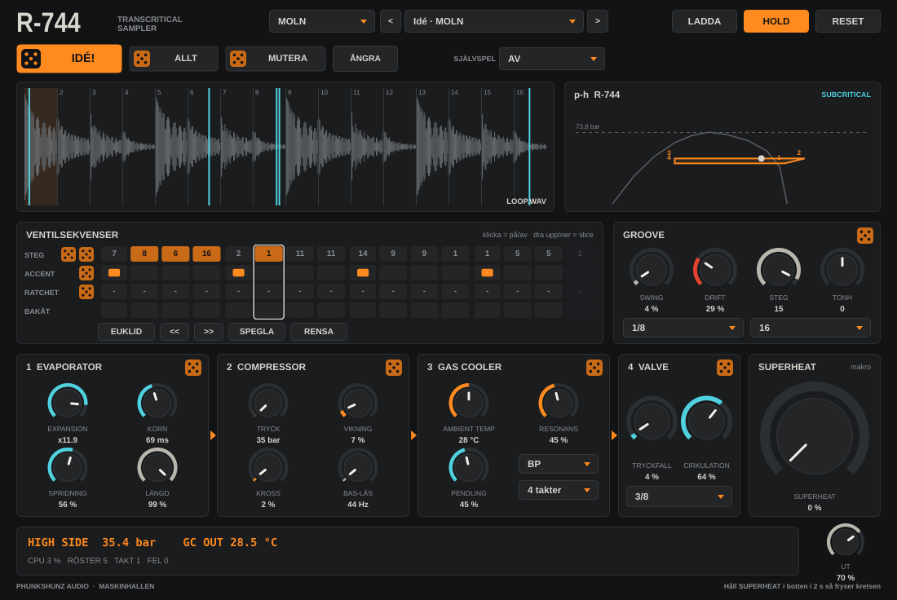

# R-744

Transkritisk sampler för techno, som VST3 och AU för macOS (och VST3 för Windows). Ladda ett ljud, så hackar R-744 det i slices och spelar dem i takt med Bitwig genom en CO2-kylkrets: förångare, kompressor, gaskylare och ventil. Kretsen går runt, ljudet med den.

Det här är ingen vanlig sampler: ljudet **cirkulerar** genom distorsion och filter i takt, ventilen **pendlar** som en termostatventil som inte hittar hem, och ett levande **p-h-diagram** visar kretsen medan du skruvar.



Ett plugin från **MASKINHALLEN**. Klicka på loggan uppe till vänster för att läsa om båtvarvet Docklands, där allt började.

## Ladda ner

https://github.com/phunkshunz/R744-VSTi/releases/latest/download/R744-macOS.zip

Dubbelklicka på zip-filen i Hämtade filer. Då får du en mapp som heter **R-744**.

Ladda inte ner via den gröna knappen **Code**. Den ger bara källkoden, inte pluginet.

## Installera på Mac

Öppna Terminal och kör:

```
bash ~/Downloads/R-744/installera.command
```

Starta om Bitwig, eller tryck **Rescan** under Settings › Locations › Plug-ins. R-744 ligger bland instrumenten. Kräver macOS 11 Big Sur eller nyare, Intel eller Apple Silicon.

## Kom igång på 10 sekunder

1. Släpp en loop eller ett trumljud på fönstret (eller tryck **LADDA**).
2. Tryck play i Bitwig. **HOLD** är på, så R-744 spelar i takt direkt.
3. Tryck **IDÉ!** tills något låter bra. Tryck igen. Och igen.

## Idéer i överflöd

- **IDÉ!** Ett nytt, genomtänkt läge från en av åtta kategorier.
- **ALLT** Vild slump över allt.
- **MUTERA** Ändrar lite här och där, behåller känslan.
- **ÅNGRA** Backar 30 steg.
- **SJÄLVSPEL** Muterar mönstret av sig själv var 2, 4, 8 eller 16 takt. R-744 spelar och utvecklar sig medan du mixar.
- **Varje del har en egen tärning:** förångaren, kompressorn, gaskylaren, ventilen, groove, och fyra tärningar för mönstret (steg, slices, accenter, ratchets).
- **Mönsterverktyg:** EUKLID, skifta åt vänster och höger, SPEGLA, RENSA.
- **128 presets** i åtta kategorier: HYPNOS, HÅRD, DUB, BRUTEN, MOLN, SKRIK, TRYCKFALL och ISKALL.

## I takt och otakt

**VENTILSEKVENSERN** har 16 steg. Klicka på ett steg för på/av, dra upp eller ner för att välja slice. Raderna under: accent, ratchet (x2 till x4) och baklänges.

GROOVE:
- **STEG** Mönstrets längd, 1 till 16. Kortare än 16 ger polyrytmer som glider mot takten.
- **SWING** Släpar varannan sextondel.
- **DRIFT** Gör den mänsklig och sen full. Steg släpar, tappas och dubblas.
- **Takt** 1/32 till 1/4, även trioler.
- **Slices** Hur många bitar ljudet hackas i: 4, 8, 16 eller 32.
- **TONH** Transponerar. MIDI-tangenterna transponerar också.

HOLD av: R-744 spelar bara när du håller en tangent, och startar om mönstret från början varje gång.

## Kretsen

| Steg | Rattar | Vad det gör |
|---|---|---|
| 1 EVAPORATOR | EXPANSION, KORN, SPRIDNING, LÄNGD | Varje slice kan sträckas till ett kornmoln (upp till 16 gånger). LÄNGD är hur länge slagen ringer. |
| 2 COMPRESSOR | TRYCK, VIKNING, KROSS, BAS-LÅS | Distorsion, triangelvikning, sample-and-hold och bitkross. BAS-LÅS låter basen gå förbi, så kicken står kvar. |
| 3 GAS COOLER | AMBIENT TEMP, RESONANS, PENDLING, typ, takt | 24 dB-filter (LP, BP eller HP). Varmare ute ger mörkare och argare ljud. PENDLING är en jagande ventil: en LFO i takt som aldrig riktigt hittar hem. |
| 4 VALVE | TRYCKFALL, CIRKULATION, tid | TRYCKFALL ger glitchar per steg: stamning, baklänges, oktavsprång, hopp och plötslig tystnad. CIRKULATION skickar det som kommit ut runt kretsen igen, i takt (1/16 till 3/8). |
| SUPERHEAT | | Trycker allt mot rött. |

Mätaren och p-h-diagrammet visar högtryckssidan och gaskylarens temperatur. Över 73,8 bar är kretsen **TRANSCRITICAL**, precis som CO2 på riktigt.

### SYSTEM FREEZE

Håll **SUPERHEAT** i botten i 2 sekunder: säkerhetsventilen blåser av i 3 sekunder och kretsen fryser till en isig drönare av det som fanns i den. Ingenting nytt kommer in förrän du trycker **RESET**.

## Säkerhet och prestanda

- Byggd för att gå på en MacBook Pro från 2013.
- Ljudtråden låser aldrig och allokerar inget minne.
- Hinner datorn inte med, minskar R-744 själv antalet korn och röster, och ökar dem igen när det lugnat sig.
- Volymen jämnas ut automatiskt och långsamt, så alla presets landar på ungefär samma nivå.
- Blir något fel i ljudet nollställs motorn. Upprepas felet går den i **SÄKERT LÄGE** tills du trycker **RESET**.

## Bygga själv

GitHub bygger automatiskt vid varje push till `main` (Actions › Bygg R-744). Zippen hamnar under Releases.
